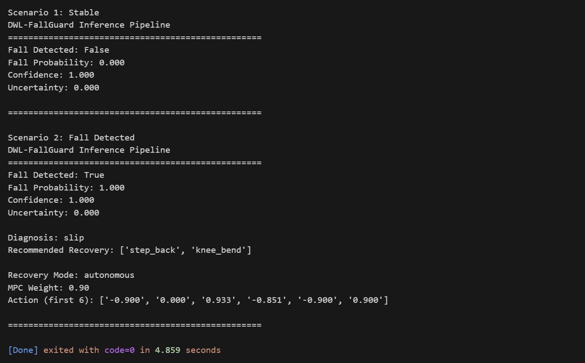

# DWL-FallGuard

[](https://opensource.org/licenses/MIT)
[](https://www.python.org/)

**Uncertainty-aware fall detection, diagnosis, and recovery for resilient humanoid robots**

DWL-FallGuard is a modular framework enabling autonomous robots to:
- 🔍 **Detect** falls with calibrated epistemic uncertainty (Bayesian Neural Networks + Monte Carlo Dropout)
- 🧠 **Diagnose** root causes using neurosymbolic reasoning (knowledge-based + state evidence)
- 🔄 **Recover** via hierarchical control blending Model Predictive Control (MPC) and Reinforcement Learning (RL)

Designed for research in **self-aware adaptive control**, **resilient autonomy**, and **human-robot collaboration**.



---

## ✨ Features

- **Uncertainty-Aware Detection**: Bayesian NN with MC Dropout for reliable fall classification
- **Explainable Diagnosis**: Symbolic knowledge base + state-based scoring for interpretable root-cause analysis
- **Adaptive Recovery**: Hybrid MPC + RL control with uncertainty-aware blending
- **Robust Training**: Synthetic data pipeline with realistic falling/stable state generation
- **Modern Packaging**: PEP 660 compliant (`pyproject.toml` + `setup.py`) — ready for pip 25.1+

---

## 🚀 Quick Start

### Prerequisites
- Python 3.8+
- PyTorch ≥ 2.0 (with or without CUDA)

### Installation
```bash
git clone https://github.com/alielhaouari01/dwl-fallguard.git
cd dwl-fallguard
pip install -e .
```

### Run the Full Pipeline
```bash
# 1. Train models (uses synthetic data)
python scripts/train.py

# 2. Evaluate performance
python scripts/evaluate.py

# 3. Run inference demo
python scripts/inference.py
```

> 💡 Models are saved to `models/` and automatically loaded in evaluation/inference.

---

## 📁 Project Structure

```
dwl-fallguard/
├── dwl_fallguard/          # Core modules
│   ├── detection.py        # FallDetector (Bayesian NN)
│   ├── diagnosis.py        # DiagnosisEngine (neurosymbolic)
│   ├── recovery.py         # RecoveryAgent (MPC + RL)
│   ├── world_model.py      # DWLExtended (dynamics + uncertainty)
│   └── utils.py            # Model saving/loading
├── scripts/                # Executable workflows
│   ├── train.py            # Training pipeline
│   ├── evaluate.py         # Performance evaluation
│   └── inference.py        # Full demo (detect → diagnose → recover)
├── docs/                   # Documentation assets
│   └── inference_demo.png  # Screenshot of demo output
├── requirements.txt        # Dependencies
├── setup.py                # Package metadata
├── pyproject.toml          # PEP 660 editable install support
├── LICENSE                 # MIT License
└── README.md
```

---

## 📈 Evaluation Metrics (Synthetic Data)

| Metric | Value |
|-------|--------|
| **F1 Score** | 0.9984 |
| **Accuracy** | 99.9% |
| **Recall** | 100% (no missed falls) |
| **Precision** | 99.68% |
| **Inference Time** | < 5 sec (GPU) |

> ✅ Trained and evaluated on 2000 synthetic states with realistic falling patterns (high velocity + tilt).

---

## 🎓 Research Context

This project implements core components of **"Self-Aware Adaptive Control for Resilient Humanoid Robots"**, focusing on:
- Failure detection with uncertainty quantification
- Neurosymbolic diagnosis of failure causes
- Autonomous recovery via hybrid control

It integrates techniques from:
- **Uncertainty-aware deep learning** (Bayesian NNs, MC Dropout)
- **Neurosymbolic AI** (symbolic rules + neural perception)
- **Resilient control** (MPC + RL blending)

> Designed for humanoid platforms but adaptable to any legged or mobile robot.

---

## 📄 License

This project is licensed under the **MIT License** — see [LICENSE](LICENSE) for details.

---

## 🙌 Acknowledgements

- Built with [PyTorch](https://pytorch.org/)
- Inspired by research in self-aware robotics and resilient autonomy
- Complies with modern Python packaging standards (PEP 660)

---

> **Note**: This system uses synthetic data for prototyping. For real-world deployment, integrate with sensor streams (IMU, joint encoders) and real-world fall datasets.
